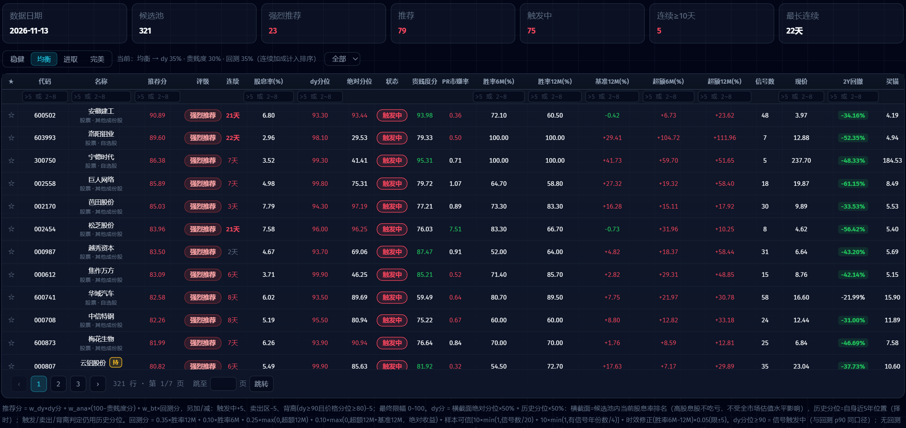

# 智能推荐 · 连续天数（Streak）· 设计与实施方案

> 状态：**设计定稿**（4 个决策点已确认），待按 S1→S5 分步实施
> 决策确认：① **在榜 = 评级**（该档基准分 ≥75；完美 = 三档基准分均 ≥75）；② 稳定性 = **峰值回撤容差 3.0 分**（锚周期内峰值，上涨不限）；③ 连续加成**只影响排序/展示分**，不改变评级档位；④ 回测重跑导致的分数跳变**算真实断点**；⑤ 上线前**回放最近 30 个交易日**，让功能当天就有内容
> 实施原则：每步独立可验证、可提交，确认后再进下一步

---

## 一、现状约束（为什么这件事不便宜）

| 事实 | 影响 |
|---|---|
| 推荐分在**浏览器**实时算（[reco.js](../web/js/views/reco.js)），后端不存分数 | 没有"历史分数"可用，必须新建历史链路 |
| `localStorage` 的 `pi_rec_scores` 只有 1 份"上一版本"快照，且在用户机器上 | 不能作为连续天数的依据（不可复现、不可回溯） |
| [scripts/_recommend_stocks.py](../scripts/_recommend_stocks.py) 的 `cache/_推荐20.json` 是**另一套评分体系** | 与智能推荐的推荐分无关，不能复用 |
| 每日 CI 15:15 跑 `update.py web` 并提交数据 | 天然形成"每交易日一条记录"的历史 |

**结论**：连续天数 = 新增一条"历史分数"链路（记录）+ 一个判定规则（计算）+ 一列展示（前端），并补 30 天回放（内容）。

---

## 二、口径定义

### 2.1 基准分（base）

`base = recoScoreOf()` 的结果，**不含连续加成**。三档（稳健/均衡/进取）各算一个；完美档不单独算分，用三档均值做展示分。

### 2.2 在榜（on-list）

| tab | 在榜判定 |
|---|---|
| 稳健 | `base.稳健 ≥ 75`（评级 = 强烈推荐） |
| 均衡 | `base.均衡 ≥ 75` |
| 进取 | `base.进取 ≥ 75` |
| 完美 | `min(base.稳健, base.均衡, base.进取) ≥ 75` |

### 2.3 连续天数（逐日递推，4 个 tab 各自独立）

```
tol = 3.0                       # 峰值回撤容差（常量，集中一处）
state[code][tab] = {n, since, peak}

每个交易日 t：
  s  = base[code][tab][t]
  on = (tab == '完美') ? min(三档) >= 75 : s >= 75

  if 该股在 t 无数据:        state = {n:0, peak:null}; 断因 = 'nodata'
  elif not on:               state = {n:0, peak:null}; 断因 = 'off'      # 跌出榜单
  elif state.n == 0:         state = {n:1, since:t, peak:s}              # 新上榜
  elif s >= state.peak - tol: state.n += 1; state.peak = max(peak, s)    # 创新高 / 峰值附近震荡
  else:                      state = {n:1, since:t, peak:s}; 断因 = 'drop'  # 回落超容差
```

要点：
- **锚峰值而非昨日**：上涨不限（"推荐分更高"），峰值附近小幅波动继续（"微小范围变动"），从峰值回落超 3 分即断。
- 断点后 `peak` 重置为当日分数，`since` 重置为当日。
- 完美档用三档**均值**做峰值基准。

### 2.4 连续加成（只进排序，不改档位）

| n | 0–2 | 3–4 | 5–7 | 8–12 | 13–19 | ≥20 |
|---|---|---|---|---|---|---|
| 加成 | 0（未确认） | +1 | +2 | +3 | +4 | +5 |

```
s_display = clamp(base + streakBonus(n), 0, 100)
```

**为什么"只影响排序、不影响评级"是自洽的（不是折中）**：
`n > 0` 的必要条件是"今日 base ≥ 75"，所以加成永远只作用于已经在强烈推荐区间内的分数 → **结构上不可能把一只 <75 的股票推过 75 线**，也不可能影响 60/45 两个档位。因此评级用 `base` 还是用 `s_display` 完全等价，不存在"显示强推但连续为 0"的怪相。

> 反例对比：若按"含加成的分数"判定在榜，会形成自反馈（74.9 +1 → 75.9 → 明日算在榜 → 加成维持），永久卡在阈值上方。故**在榜判定必须用 base**，这是硬约束。

---

## 三、三条关键洞察（含实测）

### 3.1 "比较昨天"的容差是冗余的

因为"在榜"要求 ≥75，榜内可跌幅度天然被限制在 `昨日分 − 75`：昨天 76 分今天 74 分，本来就已经掉榜，Δ 容差管不到；只有高分股（86→81，评级仍是强推）才用得上。所以容差必须锚在**峰值**上，才能过滤"仍在榜但持续走弱"。

### 3.2 日间分数波动的实测分布（容差标定依据）

用 git 里 31 个历史 `analysis.json` 快照 + 真实 [reco.js](../web/js/views/reco.js) 回算：

| 档位 | 中位 \|Δ\| | p75 | p90 | p95 | 跌幅>1 | 跌幅>2 |
|---|---|---|---|---|---|---|
| 稳健 | 0.87 | 1.96 | 3.74 | 4.28 | 27% | 13% |
| 均衡 | 0.82 | 1.93 | 2.96 | 4.07 | 21% | 9% |
| 进取 | 0.57 | 1.03 | 1.57 | 1.76 | 11% | 0% |

→ `tol = 3.0` ≈ p90 水平：日常 ±1~2 分抖动不断，跌 3 分以上（约 1/10 概率/日）才断。按此推算"20 天不掉 3 分"的概率约 5%~15%，≥20 天是稀缺级别，做评判分刚好。

### 3.3 回放成本可接受

实测：全池指标文件（363 个，143 万行）+ K 线（363 个，143 万行）读+解码 = **5.5 秒/次**。
→ 回放 30 个交易日 ≈ **3 分钟**，一次性离线操作，不进每日链路。

---

## 四、数据产物设计

### 4.1 `cache/_推荐评分历史.json`（新增，git 跟踪，append-only）

```json
{
  "version": 1,
  "dates": ["2026-09-30", "..."],
  "scores": {
    "2026-09-30": [[802, 823, 850], null, [751, 755, 760]]
  }
}
```
- 内层数组与 `dates` 同序，元素 = `[稳健, 均衡, 进取]`，单位为**分数×10 的整数**（802 = 80.2），缺失为 `null`。
- 保留最近 **120 个交易日**，超出裁剪最老日期（并写 `"truncated": true`）。
- 体积：120 日 × 321 只 × 3 值 ≈ **0.6 MB**；每日新增 1 个日期键，git diff 为 1 行。
- **append-only**：历史行永不重算（回测重跑也不改）；仅"当日"行允许幂等覆盖。

### 4.2 `web/data/reco_streak.json`（新增，前端读取，约 60 KB）

```json
{
  "date": "2026-11-13",
  "tol": 3.0,
  "history_days": 31,
  "by_code": {
    "600502": {
      "d": {                              // d = 各 tab 的连续状态
        "稳健": {"n": 27, "since": "2026-09-30", "peak": 864, "today": 859, "brk": null},
        "均衡": {"n": 27, "since": "2026-09-30", "peak": 864, "today": 859, "brk": null},
        "进取": {"n": 3,  "since": "2026-11-11", "peak": 861, "today": 859, "brk": null},
        "完美": {"n": 0,  "since": null, "peak": null, "today": 859, "brk": "off"}
      },
      "on_days": 27,                      // 在榜累计天数（该档…见下）
      "max_n": 27                         // 历史最长连续
    }
  }
}
```
- `brk`：断因码 `off`（跌出榜单）/ `drop`（回落超容差）/ `nodata`（缺数据）/ `null`（未断）。
- `on_days`/`max_n` 按**各 tab 分别存**（`{"稳健":{"on":27,"max":27}, ...}`），避免歧义。
- 只包含"历史里出现过"的标的；前端缺省按 0 处理。

### 4.3 交易日历

回放取 `cache/指数_000922.json` 收盘序列的**末 30 个交易日**；每日跑 `_gen_analysis.main(asof=当日)`，产物落 `cache/_replay/an_<date>.json`（**不进 git**，约 18 MB，加 `.gitignore`）。

---

## 五、实施步骤（S1 → S5，每步可验证）

### S1 `_gen_analysis.py` 支持 `--asof`（回放基础）

改 [scripts/_gen_analysis.py](../scripts/_gen_analysis.py)（约 +70 行，**不改非回放路径的任何行为**）：

| 函数 | 改动 |
|---|---|
| `_cut(rows, asof)`（新增） | 通用截断：支持 `[{"date":...}]` 与 `[(date, val)]` 两种行形态 |
| `build_from_close(...)` | 参数 `asof`，截断 `series_rows` 后照常取 `[-1]` 当"当日" |
| `build_stock(...)` | 参数 `asof`，截断指标行 + K 线行（对齐长度后再取 `close_now`） |
| `get_close_arr(...)` | 参数 `asof`，截断收盘序列 |
| `build_stock_factors(code, ...)` | 参数 `asof`，估值因子取 asof 当日行（而非最后一行） |
| `build_sent_etf(code, ...)` | 参数 `asof`，折溢价取 asof 当日行 |
| `price_percentile_anchor(...)` | 参数 `asof`（锚不参与评分，仅为产物完整） |
| `build_factors(dy_data, ...)` | 参数 `asof` / `out_path` / `write_series`；回放时**不写** `cache/analysis_dy.json` 与 `dy_series.json` |
| `main(only=None, ...)` | 参数 `asof` / `out_path` / `quiet`；`quiet` 时抑制控制台表格 |

**验证**：`python scripts/_gen_analysis.py`（无 asof）跑出的 `analysis.json` 与当前文件**逐字段一致**（除 date）。

### S2 `_reco_streak.mjs`（评分 + 历史 + 连续判定）

新建 [scripts/_reco_streak.mjs](../scripts/_reco_streak.mjs)（约 120 行），**直接 import 真实 `reco.js`，零公式复制**：

1. 读 `cache/_replay/an_*.json`（历史日期）+ `web/data/analysis.json`（当日）+ `backtest.json` + `manifest.json`
2. 每个日期：`buildRecoPool()` → 三档 `recoScoreOf()` → 三档 base 分
3. 追加/覆盖 `cache/_推荐评分历史.json`（历史行只增不改，当日行幂等覆盖）
4. 逐日递推 2.3 的状态机 → 写 `web/data/reco_streak.json`
5. 导出纯函数 `advanceStreak(state, score, tol)` / `streakBonusOf(n)` 供单测

**注意**：回测分恒用当日 `backtest.json`（无历史 bt），所以 30 天回放内部自洽、不含"回测重跑"假跳变；回测重跑后**未来**的分数才跳变 → 按决策④算真实断点。

### S3 回放最近 30 个交易日（一次性）

新建 [scripts/_reco_replay.py](../scripts/_reco_replay.py)（约 60 行）：

1. 取 000922 末 30 个交易日
2. 逐日 `ga.main(asof=d, out_path="cache/_replay/an_<d>.json", quiet=True)`（`redirect_stdout` 静音）
3. `--verify` 自检：`asof=今日` 的产物与真实 `analysis.json` 逐标比较**因子分位**，最大差 ≤0.1（证明截断机制无失真）
4. 结束后调用 `node scripts/_reco_streak.mjs` 生成历史 + streak 文件

**验证**：`reco_streak.json` 的 `history_days == 31`；当日榜单与页面现有结果一致；随机抽 3 只人工核对连续天数与分数路径。

### S4 前端（4 个 tab 各一列）

| 文件 | 改动 |
|---|---|
| [web/js/data.js](../web/js/data.js) | 新增 `STREAK_URL = '/web/data/reco_streak.json'`，加入导出与 `PINNED` |
| [web/js/views/reco.js](../web/js/views/reco.js) | 新增 `STREAK_TOL = 3.0`、`streakBonusOf(n)`；`recoScoreOf(..., streakDays = 0)` 加可选入参，返回值加 `streakBonus`（**默认 0 → holdingsView 行为不变**） |
| [web/js/views/recommendView.js](../web/js/views/recommendView.js) | 并行加载 streak；行数据挂 `r.streakN/r.streakState`；「评级」后插入「连续」列（可排序）；`s` 用 `s_display` 排序与展示；分数 tooltip 加"连续 +N"；汇总条加"连续≥10天/最长"；底部说明加 2 行 |

**列显示规则**：`n ≥ 3` 显示 `N天`（≥10 天加粗），`n = 1~2` 显示 `N天` 灰色（未确认），`n = 0` 显示 `—`。

**tooltip 文案**：
```
均衡连续 12 个交易日（2026-10-28 起）
分数 76.2 → 82.4｜期内峰值 83.1｜距峰值 −0.7（容差 3.0）
在榜累计 18 天｜历史最长 12 天
完美：连续 4 天（稳健 6 天 / 进取 2 天）
```
断点股票额外一行：`今日新上榜：昨日因回落 4.2 超容差中断`。

**验证**：`cp f.js /tmp/f.mjs && node --check`（ESM 必转 `.mjs`）；浏览器冒烟用 playwright-core + 系统 Edge，探测 4 个 tab 的「连续」列存在、tooltip 文案、点击表头排序生效。

### S5 接进每日链路 + 测试 + 文档

| 文件 | 改动 |
|---|---|
| [update.py](../update.py) | `_web_steps()` 在「manifest v2」之后插入 `("推荐连续", "连续天数", src_main)`；`src_main` 用 `shutil.which("node")` 检测，缺失则抛清晰错误（被 `isolate=True` 捕获 → 告警不中断） |
| `.github/workflows/daily-update.yml` | 数据 job 加 `actions/setup-node@v4`（node 20） |
| `tests/frontend/reco_streak.test.mjs` | 新增：状态机（新上榜/创新高续/跌破 75 断/回落 3.1 断/回落 2.9 续/缺数据断）+ `streakBonusOf` 边界（2→0、3→1、19→4、20→5、200→5）+ 幂等 |
| 本文档 | 施工记录与最终校准值 |

**产物关系断言**（写在 `_reco_streak.mjs --check` 里，遵守"禁硬编码/禁快照"）：
- `reco_streak.date === manifest.data_date`
- 每条 `d[tab].n > 0` 的标的，今日该档 base ≥75
- 每条 `d[tab].n === 0` 的标的，今日该档 base <75 或历史里无数据
- `history_days === dates.length`
- `on_days ≥ max_n`，且 `since` 是 `dates` 中的合法日期

---

## 六、改动文件清单

| # | 文件 | 动作 | 规模 |
|---|---|---|---|
| 1 | `scripts/_gen_analysis.py` | 改 | +70 行 |
| 2 | `scripts/_reco_replay.py` | 新 | ~60 行 |
| 3 | `scripts/_reco_streak.mjs` | 新 | ~120 行 |
| 4 | `cache/_推荐评分历史.json` | 新（产物） | ~0.6 MB |
| 5 | `web/data/reco_streak.json` | 新（产物） | ~60 KB |
| 6 | `web/js/data.js` | 改 | +2 行 |
| 7 | `web/js/views/reco.js` | 改 | +15 行 |
| 8 | `web/js/views/recommendView.js` | 改 | +45 行 |
| 9 | `update.py` | 改 | +6 行 |
| 10 | `.github/workflows/daily-update.yml` | 改 | +4 行 |
| 11 | `tests/frontend/reco_streak.test.mjs` | 新 | ~50 行 |
| 12 | `docs/智能推荐-连续天数-设计方案.md` | 新（本文） | — |

**不动**：`holdingsView.js`（`streakDays` 默认 0，持仓建议口径不变）、回测脚本与 `docs/回测报告.md`、`_recommend_stocks.py`。

---

## 七、边界与已知局限

| 情形 | 行为 |
|---|---|
| 当日跌出 75 | 断（`off`），连续归 1 / 显示"今日新上榜" |
| 从峰值回落 > 3.0 | 断（`drop`），tooltip 显示回落幅度 |
| 新进候选池（无历史） | 从 1 起算 |
| 停牌 | asof 回放沿用最近可用价格 → 分数不变 → **连续延续**（语义："每天都仍处于强推"）；若希望停牌即断，需改为按 K 线是否当日有 bar 判定 |
| 缺某交易日整体数据（漏跑） | 该日不在 `dates` 里 → 判定为缺口，断（`nodata`），避免把漏跑算成持续 |
| 回测重跑导致分数整体跳变 | 按决策④**算真实断点**；tooltip 显示分项，便于识别是回测口径变化 |
| 历史窗口 120 日 | 连续超过 120 天会被裁到窗口上沿（显示 `120+`），实际业务上足够 |
| 同一日重复跑 | 只覆盖"当日"行，历史行不改 |

---

## 八、上线后校准（累积 1~2 个月后）

目标分布（用来回检 `tol` 是否合适）：

| 指标 | 目标 |
|---|---|
| 均衡档在榜股的中位连续天数 | 5~8 天 |
| `tol=3` 下 ≥20 天的标的占比 | 3%~8% |
| 每日因果"断"（`drop`）的比例 | 15%~25% |

若中位连续 <3 天 → 放宽到 4.0；若 ≥20 天占比 >15% → 收紧到 2.5。`tol` 只改 `web/js/views/reco.js` 的 `STREAK_TOL` 与 `_reco_streak.mjs` 的同名常量（**两处必须同步**，或由 streak 文件下发 `tol` 供前端读，推荐后者：前端只读 `reco_streak.tol`）。

---

## 九、工作量

| 步骤 | 估时 | 实际 |
|---|---|---|
| S1 asof 改造 | 1 h | ✅ 约 40 分钟 |
| S2 评分+历史+判定脚本 | 1.5 h | ✅ 约 1 小时 |
| S3 回放 30 日（含运行与核对） | 0.5 h | ✅ 实际约 15 分钟运行（30 × ~30 秒） |
| S4 前端 4 tab 列/tooltip/汇总/排序 | 2 h | ✅ |
| S5 管道+CI+单测+文档 | 1.5 h | ✅ |
| 合计 | 约 7 h | 约 5~6 h（回放比预估慢：单次全量重算实测 **26 秒**，非最初估计的 5.5 秒） |

---

## 十、施工记录（2026-11-15 实施）

### 10.1 与设计的偏差

| 项 | 设计 | 实际落地 | 原因 |
|---|---|---|---|
| 连续加成所在模块 | 计划加在 `recoScoreOf` 的可选入参 | **只加在 `reco.js` 的 `streakBonusOf()`，由视图层应用** | `recoScoreOf` 保持纯函数签名不变 → `holdingsView` 零改动、零风险 |
| 常量归属 | `reco.js` 与 `_reco_streak.mjs` 各写一份 `tol` | **`STREAK_TOL` 只在 `reco.js` 定义，mjs `import` 复用**（产物再下发 `tol` 给前端） | 避免两处常量漂移 |
| 回放耗时 | 5.5 秒/次（仅统计读文件） | **26 秒/次**（含因子重算 + 全池遍历），30 天约 15 分钟 | 首次估算漏算因子计算；仍是一次性离线操作，可接受 |
| Node 解析 `web/js/*.js` | 未提及 | **新增 `web/js/package.json` `{"type":"module"}`** | 让 `_reco_streak.mjs` 能直接 `import` 真实 `reco.js`（单一来源），不必运行时拷贝成 `.mjs`；副作用是 `node --check web/js/*.js` 也可直接跑 |

### 10.2 验证结果

| 验证 | 结果 |
|---|---|
| S1 非回放路径零影响（重跑 `python scripts/_gen_analysis.py` 对比备份） | 386 标的 / **因子分位差异 0**，`dy_series.json` 一致 |
| S1 回放自检 `python scripts/_reco_replay.py --verify` | 比较 **2270 个因子分位，缺标的 0，最大差 0.000000** |
| S1 回放不覆盖生产产物 | `git status web/data/analysis.json web/data/dy_series.json cache/analysis_dy.json` 无变更 |
| S2 当日单独跑 | 50 标的入产物；在榜 稳健45/均衡23/进取15/完美12（与独立探测一致） |
| S2 关系断言 `node scripts/_reco_streak.mjs --check` | 全部通过 |
| S4 浏览器（Edge headless，4 个 tab） | 「连续」列存在且紧邻「评级」；tooltip 含连续天数/峰值/容差/在榜累计/各档；**评级与展示分无跨档**；点表头可升/降序；无 JS 异常 |
| 前端单测 | 新增 7 项，全仓 **67 项全绿** |
| Lint | 改动文件 `ruff check` 全绿（仓库另有 5 条历史遗留错误，未触碰） |

### 10.3 上线效果（均衡档，2026-11-13）



四个标签各自计数，互不干扰（例：300750 在进取档连续 31 天、在均衡档仅 7 天）；≥3 天才上色，1~2 天灰色表示"未确认"；汇总条新增「连续≥10天」「最长连续」。

### 10.4 已知注意点

1. `scripts/_reco_replay.py` 顶部必须**预导入** `_fetch_watchlist`：该模块 import 时会 `sys.stdout.reconfigure()`，而回放用 `redirect_stdout(StringIO)` 静音输出，导入顺序错了会 `AttributeError`。
2. 历史文件 append-only：**除"当日"行**外不允许覆盖；回测重跑不会改写历史分数（决策④只影响未来）。
3. `cache/_replay/` 已加入 `.gitignore`（约 18MB 运行产物，不进 git）。
4. 回放用的是**当日回测分**（无历史 `backtest.json` 版本），故 30 天回放内部自洽；回测重跑后新产生的分数跳变按"真实断点"处理。
5. 停牌：`asof` 回放沿用停牌前最后价格 → 分数不变 → 连续延续（语义：每天都仍处于强推）。

### 10.5 日常运维

| 场景 | 命令 |
|---|---|
| 每日更新（CI 自动，含连续天数） | `python update.py web` / `daily` |
| 重算连续天数（不改历史） | `node scripts/_reco_streak.mjs --check` |
| 重建 30 天历史（换机器/口径变更后） | `python scripts/_reco_replay.py --days 30` |
| 校准容差 | 改 `web/js/views/reco.js#STREAK_TOL` → 重跑 `_reco_replay.py` |

⚠️ **重建历史的唯一方式**：历史文件 append-only，已有日期不会被回放覆盖。若确需按新口径从头重算，先删除 `cache/_推荐评分历史.json` 再跑回放（这会丢掉全部既有连续记录，非必要不做）。


